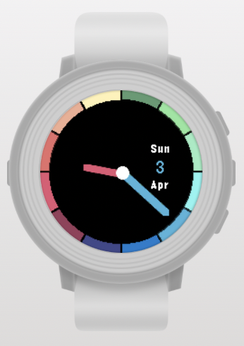

# Analog Rainbow

Pebble watchface with a colorful bezel and colored watch hands.
You can find it on the [rebble app store](https://apps.rebble.io/en_US/application/57016a58cd2a15ffcd000041?native=false&query=analograin&section=watchfaces)

## How it works

The 12-segment colored rim and the hands are drawn programmatically (vector
drawing), so the face scales to any display size and shape. Each hand takes on
the color of whichever rim segment it currently points at.

## Supported platforms

`basalt` (Pebble Time), `chalk` (Pebble Time Round) and `emery` (Pebble Time 2).
On rectangular displays the dial stays circular and the leftover corners are
decorated with arcs that echo the nearest rim colors.

## New in 2.0

- Rewritten for modern hardware; resolution independent rendering.
- Circular dial on rectangular screens with decorated corners.
- Battery level shown as a ring inside the bezel.
- Optional second hand.
- Config page (Clay) fixed so all toggles actually apply.
